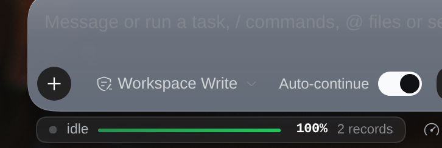

# dsh-conv-progress

> DSH（DeepSeek Harness）插件：在对话输入框**下方常驻**一条任务进度胶囊 —— 运行中显示实时进度条、预估剩余时间与当前阶段；空闲时保持 100%；**点击胶囊可回看该会话每一轮任务的历史记录**。
>
> *A DSH plugin that keeps a progress capsule under the composer: live progress bar, ETA and current phase while a turn runs, a permanent 100% state when idle, and a click-to-open history of every turn in the session.*
>
> GitHub: <https://github.com/picklerick422/dsh-conv-progress> · Releases: <https://github.com/picklerick422/dsh-conv-progress/releases> · Issues: <https://github.com/picklerick422/dsh-conv-progress/issues>


---

## 它长什么样



- **运行中**：`● calling bash │ ▓▓▓▓░░ 87% │ ~5m17s left`，进度条 150×3px，ETA 每秒刷新。
- **低置信度**（当前采样不足以支撑估算）：斜纹不确定条，只显示 `已用 12m40s`，绝不硬凑一个数字。
- **空闲**：`● idle │ 100% │ 2 records`，胶囊不消失；点击查看历史。
- **结束**：正常结束的一轮以 `本轮完成 100%` 停留约 6s（linger）后转入空闲态。

## 功能

| 能力 | 说明 |
| --- | --- |
| 进度条 | 时间型估算：`已用 / (已用 + 剩余时间中位数预测)`，上限 97%；无把握时退化为不确定态 |
| ETA | **400 棵分位回归树（32 特征）** 预测剩余时间中位数 + EMA 显示平滑；hover 可看保形区间；低置信度自动隐藏 |
| 置信度 | 按「校准后的期望相对误差」三档（高 ≤0.35 / 中 ≤0.90 / 低 >0.90），首轮再降一档；低档只显示已用时间 |
| 阶段标签 | `thinking`（模型流式中）· `calling <tool>`（工具执行中）· `preparing` · `done` · `idle` |
| 计划校准 | 会话出现 `todo/write` 时，进度 = 计划完成度 0.6 + 时间进度 0.4；计划全完成但仍在干活时退回纯时间进度 |
| 历史记录 | 点击胶囊向上弹出该会话的任务列表：轮次 / 结束原因 / 时间 / 耗时 / 步数 / 工具次数 / 计划完成数 / 置信度，可滚动 |
| 历史来源 | 宿主内存环形缓冲（默认 100 条/会话），重启后由 `bootstrap()` 从会话事件流重放重建，无需额外落盘 |
| 主题适配 | 只用 DSH 主题令牌（`--dsw-alias-*`），深浅色 / 玻璃质感一致；`prefers-reduced-motion` 自动降级 |
| 无障碍 | 胶囊为 `<button aria-haspopup="dialog">`，内部 `role="progressbar" aria-valuenow`；`Esc` / 外部点击关闭浮层 |
| i18n | 中 / 英双语，跟随 DSH locale |

## 安装

> 已在 dsh `0.2.1-rc.2`、profile `web`、Node 22 上验证。

### A. 从 Release 安装（推荐）

```bash
# 直接从 GitHub 仓库安装（仓库根即插件包）
dsh plugin add github:picklerick422/dsh-conv-progress

# 或用 Release 里的预构建 tarball 手动安装
curl -LO https://github.com/picklerick422/dsh-conv-progress/releases/latest/download/dsh-conv-progress.tgz
mkdir -p /tmp/dsh-conv-progress && tar -xzf dsh-conv-progress.tgz -C /tmp/dsh-conv-progress
cp -r /tmp/dsh-conv-progress/package ~/.dsh/profiles/web/node_modules/dsh-conv-progress
# 再在 ~/.dsh/profiles/web/cordis.patch.yml 追加：
#   - insert:
#       - id: conv-progress
#         name: dsh-conv-progress
```

或在 dsh-market 的 Discover 里搜 `dsh-conv-progress` 一键安装。

### B. 热注入（开发期，重启后失效）

```js
dev_inject_plugin({ dir: "<本仓库>" })                              // 回执：host ✓ client ✓
dev_plugin_status()                                                // 清单出现 (dsh-conv-progress)
dev_reload_package("conv-progress")                                // 改代码后热重载
```

### C. 持久安装（重启后仍在）

```js
dev_install_package({ dir: "<本仓库>", profile: "web" })
```

它会把 `link:` 依赖写进 profile 的 `package.json`（dependencies + bundles）并建 `node_modules` junction —— **这会修改 profile 配置**，请自行确认后执行。

### D. 手动安装（等价于 C）

```bash
ln -s <本仓库>  ~/.dsh/profiles/web/node_modules/dsh-conv-progress
# 再在 ~/.dsh/profiles/web/cordis.patch.yml 追加：
#   - insert:
#       - id: conv-progress
#         name: dsh-conv-progress
```

**依赖解析**：`lib/index.js` 以裸 import 引用 `@deepseek-ai/{dsh-typert-protocol,schemastery}`，需从 dsh 安装目录解析。仓库不提交 `node_modules`；从源码本地开发时重建软链：

```bash
cd <本仓库>
D=<dsh 安装目录>/node_modules/@deepseek-ai      # 如 ~/.nvm/.../node_modules/@deepseek-ai/dsh/node_modules/@deepseek-ai
mkdir -p node_modules/@deepseek-ai
for p in dsh-typert-protocol schemastery cordis; do ln -sfn "$D/$p" "node_modules/@deepseek-ai/$p"; done
```

## 配置

宿主服务 Config（`cordis.patch.yml` 的 `config:` 段）：

| 键 | 默认 | 说明 |
| --- | --- | --- |
| `debug` | `false` | 把每次快照写入 `~/.dsh/conv-progress/debug.jsonl`（256KB 轮转，每会话最多 3 条） |
| `priorStepMs` | `13200` | 单步先验耗时（ms），仅用于退化路径与展示 |
| `priorStepsPerTurn` | `9` | 单轮先验步数（实测中位 9 / 均值 21），仅用于退化路径与展示 |
| `historyLimit` | `100` | 每会话保留的历史条数（环形缓冲，保留最新） |
| `prior.enabled` | `false` | **实验特性**：轮次开始时旁路问一次 LLM 要「步数/分钟」先验。实测无收益，默认关闭，见设计文档 §14 |
| `prior.provider` / `prior.model` | `''` | 先验调用用哪个模型；空 = 跟随 `agentDefaultModel` 当前选择 |
| `prior.timeoutMs` | `2500` | 先验调用超时；超时/失败 = 该轮没有先验，行为与未开启一致 |
| `prior.blendWeight` | `0` | 先验与模型 ETA 的 log 空间混合权重；**实测最优值就是 0** |

其余超参见 `lib/estimator.js` 的 `DEFAULT_PARAMS`（`percentCap 0.97`、`etaAlpha 0.4`、`planPercentWeight 0.6`…）。

## 算法与准确性

ETA 是**离线训练的分位回归模型**，不是手调公式：`lib/eta-v3-model.js` 由 `tools/analysis/eta_report.py` 在 816 个真实会话（7,178 轮 turn）上训练并导出为纯 JSON 树（400 棵树 × 31 叶，759 KB，推理 ~50µs），宿主侧零网络依赖。

- **32 维在线特征**：步数 / 已用时间 / 步内工具状态（core 9）＋ 会话与轮次节奏（pace 6）＋ 提示词形状与计划（turnmeta 12）＋ 本轮工具计数（tools 5）；全部是事件流里此刻已知的信息，**没有任何前视特征**（`tools/check-features.mjs` 逐特征比对训练表与生产端，32/32 一致）。
- **区间**：按预测 ETA 分桶的保形分位给出 80% 区间（实测覆盖 76.5–79.7%）。
- **置信度**：按校准后的相对误差分档（high/medium/low），低档前端只显示已用时间。

离线回放（test 集：137,263 采样 / 239 会话 / 1,600 轮，全部走线上 JS 推理）：

| 指标 | v1（step 当量） | v2（生存表） | v3（分位 GBM） |
| --- | --- | --- | --- |
| MAE | 5.7m | 4.4m | **2.14m** |
| medianAE | 3.6m | 2.2m | **43s** |
| MAPE（capped 5×） | 1.69 | 1.41 | **0.845** |
| ±30% 命中率 | — | 24.9% | **54.8%** |
| ±50% 命中率 | — | 37.4% | **66.0%** |

分轮时长 MAE（v2 → v3）：`<30s 1.9m → 1.17m`、`30–120s 1.8m → 48s`、`2–5m 1.7m → 48s`、`5–15m 3.1m → 1.48m`、`>15m 9.0m → 4.36m`。

> 误差从哪来：v2 的 MSE 分解显示 bias² 只占 6.7%、variance 占 93.3%；即使把「本轮总步数」当 oracle 喂进去，MAE 也只能到 59s。结论：**缺的是任务规模先验，而非拟合精度**——这也是 v3 引入提示词形状 / 计划 / 会话节奏特征的原因。完整推导、候选对比与「先问 LLM 要输入」的可行性评估见 [`docs/dsh-conv-progress.md`](docs/dsh-conv-progress.md) §12–§13。

**那直接问 LLM 要「这活要多久」行不行？** 做了实验（§14）：500 轮真实提示词、两个问法（直接数值 / 分桶 few-shot）、三种评估（先验自身准度、当特征重训、与 v3 混合）。结论是**当前形态没有收益**——先验噪声 σ≈1.3（门槛 0.3）、分钟数系统性高估 2.9×、当特征让 MAE 变差 22%、混合最优权重为 0。因此这条能力实现为默认关闭的实验分支。

## 目录结构

```
.                               # ← 仓库根就是插件包（可直接 dsh plugin add github:…）
├── lib/
│   ├── index.js                # 宿主：session/event 采集 + 状态机 + @Remote('snapshot'/'history')
│   ├── estimator.js            # v2 估算器（生存表 + 时间进度，v3 的失败回退路径）
│   ├── eta-model.js            # v2 拟合产物：FINE/COARSE 生存表 + lookupEtaMs()
│   ├── estimator-v3.js         # v3 估算器：特征回放 + 分位预测 + 保形区间 + 置信度
│   ├── features.js             # 训练/生产共用的 32 维特征状态机（唯一实现）
│   ├── eta-v3.js               # 纯 JS 树推理 + 保形区间 + 置信度分档
│   ├── eta-v3-model.js         # v3 拟合产物（400×31 树，759 KB，自动生成勿手改）
│   ├── history.js              # 纯函数：任务标题提取 / 结束原因归一 / 置信度评级 / 环形缓冲
│   └── client.js               # 浏览器 bundle：胶囊 + 历史浮层 + 样式 + i18n
├── test/                       # node:test（10 v2 估算器 + 9 v3 估算器 + 7 历史，共 26 用例）
├── assets/                     # README 截图
├── cordis.patch.yml            # 宿主装配
└── package.json                # dsh.bundle + dsh.client 声明
tools/                          # 数据管线：抽取 → 采样 → 训练/导出 → 一致性校验 → 离线评估
docs/dsh-conv-progress.md       # 设计文档：调研 / 可行性 / 实现 / 验证 / 算法
research/                       # 立项调研：同类项目与 DSH 内部机制
```

## 开发

```bash
cd <本仓库>
node --test test/estimator.test.mjs test/estimator-v3.test.mjs test/history.test.mjs   # 26 pass / 0 fail
node --check lib/client.js && node --check lib/index.js && node --check lib/estimator-v3.js
```

离线评估（需要自己的会话日志，**不入库**）：

```bash
node tools/extract-turns.mjs 0 data/turns-all.jsonl     # 读 ~/.dsh/sessions，产出每轮紧凑记录
node tools/build-eta-model.mjs --data data/turns-all.jsonl \
  --out lib/eta-model.js      # 只用 train 划分拟合生存表
node tools/eval-eta.mjs --data data/turns-all.jsonl \
  --impl lib/estimator.js --reasons completed --split test --json data/eval-v2.json
node tools/eval-eta.mjs --data data/turns-all.jsonl \
  --impl tools/fixtures/estimator-v1.mjs --reasons completed --split test --json data/eval-v1.json   # 基线
```

> `data/`、`probes/`（真实会话日志与 GUI 截图，含个人内容）与 `node_modules/` 已在 `.gitignore` 中排除。
>
> Release/npm tarball 只打包运行所需文件（`lib/`、`assets/`、`cordis.patch.yml`、`README.md`、`LICENSE`）；`test/`、`tools/`、`research/`、`docs/` 仅存在于源码仓库。

## 已知限制

- **提示词注入先验默认关闭**：实测没有收益（§14），打开只会多一次 LLM 调用。

- 短轮（<30s）仍系统性高估、轮尾最后几分钟 ETA 偏长、首轮冷启动最差——这些是 v3 的已知残余（设计文档 §13.7）。

- **百分比是统计推断**：DSH 没有「总工作量」事件，进度只能来自可观测信号（模型自报进度不可靠，见 `research/research-progress-eta.md`）。
- 没有 `todo/write` 时退化为纯时间型进度（tool-todo 默认可能未启用，属常态）。
- **模型有保鲜期**：换模型 / 换工具分布后建议重跑 `tools/analysis/eta_report.py` 重新导出 `lib/eta-v3-model.js`（`model.meta` 记录训练集规模、指标与配置）。
- **首轮仍最不准**：冷启动（会话第一轮）MAE 3.2m，稳定后 1.5–2.7m；因为还没有本会话的节奏样本。
- **轮尾仍偏长**：最后几分钟 ETA 一般偏保守（只凭可观测信号无法判断「马上就要结束」），结束时直接跳 100%。
- **区间有下限**：80% 保形区间的实测覆盖率 76.5–79.7%，对 30–60m 长轮略不足（样本少）。
- 依赖 dsh 内部 API（`session/event`、`TypertRemoteService`、slot 名 `conversation.composer.dock`），dsh 升级需回归。
- 空闲时胶囊常驻占 22px 高度；如不想要，可删掉 `idle` 分支或加 CSS `display:none`。
- 历史记录是宿主内存态；dsh 重启后靠 `bootstrap()` 重放事件流重建，因此只有仍保留在会话 JSONL 里的轮次。

## 许可证

BSD-3-Clause，见 [LICENSE](LICENSE)。
