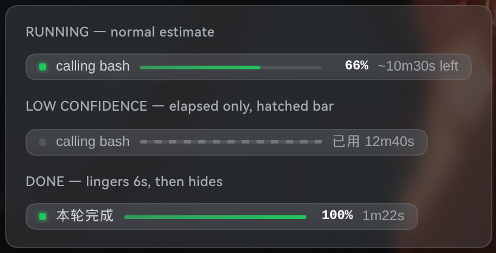

# dsh-conv-progress · 详细参考

> 这是插件包的完整参考（功能明细、架构、数据契约、验证记录）。快速上手看 [根 README](../README.md)；设计与算法推导看 [`dsh-conv-progress.md`](dsh-conv-progress.md)。
>
> DSH（DeepSeek Harness）插件：在当前对话的输入框下方，**常驻**显示任务进度胶囊（运行中 = 实时进度条 + 预估剩余时间 + 当前阶段；无任务 = 100%），**点击胶囊可查看该会话的历史任务记录**。


上图是本插件在真实 GUI（`:3080`）中的实拍：`● calling bash │ ▓▓▓▓░░ 87% │ ~5m17s left`。



空闲态（100% + 历史条数）见 [`assets/idle.png`](../assets/idle.png)。

---

## 1. 功能

| 能力 | 说明 |
| --- | --- |
| 进度条 | 估算完成度 1–97%（时间型：已用 /（已用 + 预计剩余中位数）），无把握时渲染为不确定态（细条纹），绝不硬凑 100% |
| ETA | `~Xm Ys left` / `~Xs left`，来自 **7108 轮真实会话拟合的经验生存表**（条件中位数），再做 EMA 平滑；估算不可靠时自动退化为只显示已用时间 |
| 阶段标签 | `thinking`（模型思考/流式中）· `calling <tool>`（工具执行中）· `preparing` · `done` |
| 计划校准 | 会话里出现过 `todo/write` 时，进度按「计划完成度 0.6 + 时间进度 0.4」融合；计划全完成但仍在干活时退回纯时间进度 |
| 历史来源 | 宿主内存环形缓冲（`historyLimit`，默认 100 条/会话）；宿主重启后由 `bootstrap()` 从会话事件流重放重建，无需持久化文件 |
| 常驻显示 | 无任务时**不隐藏**：显示 100%、灰点、`idle`，有历史时尾随 `N records`（v3） |
| 历史记录 | 点击胶囊向上弹出该会话的任务列表：轮次 / 结果 / 时间 / 耗时 / 步数 / 工具次数 / 计划完成数 / 置信度，可滚动回看（v3） |
| 结束态 | 一轮正常结束后仍显示 `finished` + 已用时间约 6s（linger），随后转入 100% 常驻态 |
| 主题适配 | 只用 DSH 主题令牌（`--dsw-alias-*`），深浅色 / 玻璃质感均可 |
| 挂载位置 | `conversation.composer.dock`（输入框下方 ambient 行），`order: -1` 排在官方的 turns/steps 与 token 用量 pill 之前 |
| 视觉规格 | 22px 高胶囊 + 150px 进度条 + 6px 状态点，11.5px 等宽数字；低置信度改为斜纹条且只显示已用时间 |
| 无障碍 | 胶囊为 `<button aria-haspopup="dialog">`，内部 `progressbar role=progressbar aria-valuenow`；`Escape` / 外部点击关闭浮层；`prefers-reduced-motion` 自动降级；窄屏隐藏次要字段 |
| i18n | 中 / 英双语，跟随 DSH locale |

## 2. 架构

```
              ┌──────────────────── host (Node) ────────────────────┐
session/event │  ConvProgressService                                │
  ───────────▶│   · 每 session 一个 ProgressState（turn/step/tool/…）│
              │   · estimator.js：生存表查剩余时间 + 时间型进度      │
              │   · @Remote('snapshot') → 扁平 view model            │
              └───────────────────────┬─────────────────────────────┘
                                      │  RPC  /api  convProgress/snapshot
              ┌───────────────────────┴─────────────────────────────┐
              │  client (browser, 手写 module-loader bundle)         │
              │   ConvProgressDock → conversation.composer.dock     │
              │   snapshot: 900ms(running) / 4000ms(idle)          │
              │   history : 3000ms(浮层打开时)                │
              └─────────────────────────────────────────────────────┘
```

**为什么「宿主采集 + 客户端轮询」**：宿主侧能拿到 `session/event` 的完整事件流（含 `event.time` 时间戳、`usage`、工具名），并可重放历史（`session.snapshotEvents()`）让**中途打开 GUI 也能立刻算对**；客户端只需要一个扁平快照，不需要理解事件模型。该模式已被生态插件 `dsh-job-progress` 验证（同为 `TypertRemoteService` + `/api` RPC）。

> 架构终态推荐「会话投影（`ctx.sessionProjections.register`）+ `props.useProjection`」——框架 push、零轮询。见 `docs/dsh-conv-progress.md` §5 的升级路径；两种通道共用同一个 `estimator.js` 与 view model，迁移只动 client 取数约 20 行。

## 3. 目录

```
.                       # 仓库根 = 插件包
├── lib/
│   ├── index.js        # 宿主：事件采集 + 状态机 + @Remote('snapshot') + @Remote('history')（529 行）
│   ├── estimator.js    # 纯函数估算器：查表 + 时间进度 + 平滑（297 行）
│   ├── eta-model.js    # 拟合产物：FINE/COARSE 生存表 + lookupEtaMs()（119 行）
│   ├── history.js      # 纯函数：任务标题提取 / 结束原因归一 / 置信度评级 / 环形缓冲（88 行）
│   └── client.js       # 浏览器 bundle：胶囊 + 历史浮层 + 样式 + i18n（737 行）
├── test/estimator.test.mjs   # node:test，10 个用例
├── test/history.test.mjs     # node:test，7 个用例
├── cordis.patch.yml    # 宿主装配：- insert: [{ id: conv-progress, name: dsh-conv-progress }]
└── package.json
```

## 4. 安装

> 本机（`~/.dsh`，profile `web`，dsh `0.2.1-rc.2`）已**热注入并验证通过**，无需重启。

### A. 从 GitHub Release 安装（推荐）

```bash
# 1) 下载并解包（222KB，含 lib/ assets/ cordis.patch.yml package.json）
curl -LO https://github.com/picklerick422/dsh-conv-progress/releases/latest/download/dsh-conv-progress.tgz
mkdir -p /tmp/dsh-conv-progress && tar -xzf dsh-conv-progress.tgz -C /tmp/dsh-conv-progress

# 2) 放进 profile 的 node_modules
cp -r /tmp/dsh-conv-progress/package ~/.dsh/profiles/web/node_modules/dsh-conv-progress

# 3) profile 的 cordis.patch.yml 追加装配行
#    - insert:
#        - id: conv-progress
#          name: dsh-conv-progress
```

也可以在插件市场（dsh-market 的 Discover）里搜 `dsh-conv-progress` 一键安装。

### B. 热注入（开发期，重启后失效）

```
dev_inject_plugin({ dir: "/home/user/.dsh/dsh-taskbar" })
# 回执：host ✓  client ✓
dev_plugin_status()        # 清单末尾出现 [active] …(dsh-conv-progress)
dev_reload_package("conv-progress")   # 改代码后热重载
```

### C. 持久安装（重启后仍在）

```
dev_install_package({ dir: "/home/user/.dsh/dsh-taskbar", profile: "web" })
```

它会把 `link:` 依赖写进 `~/.dsh/profiles/web/package.json` 的 dependencies + bundles，并建 `node_modules` junction；**这会改 profile 配置**，按全局规范需用户确认后执行。

### D. 手动（等价）

```bash
ln -s /home/user/.dsh/dsh-taskbar \
      ~/.dsh/profiles/web/node_modules/dsh-conv-progress
# 再在 profile 的 cordis.patch.yml 追加：
#   - insert:
#       - id: conv-progress
#         name: dsh-conv-progress
```

**依赖解析**：`lib/index.js` 里 `import z from '@deepseek-ai/schemastery'`、`import { Remote, TypertRemoteService } from '@deepseek-ai/dsh-typert-protocol'` 是裸 import，需要能解析到 dsh 安装内的包。本插件目录下已建：

```
node_modules/@deepseek-ai/{dsh-typert-protocol,schemastery,cordis} → ~/.nvm/versions/node/v22.23.2/lib/node_modules/@deepseek-ai/dsh/node_modules/@deepseek-ai/*
```

拷贝插件到别处时需重建这三个软链（或把它装进 profile 的 `node_modules`，由 profile 解析）。

## 5. 配置

宿主服务 Config（`cordis.patch.yml` 的 `config:` 段）：

| 键 | 默认 | 说明 |
| --- | --- | --- |
| `debug` | `false` | 打开后把每次快照写 `~/.dsh/conv-progress/debug.jsonl`（256KB 轮转，每会话最多 3 条） |
| `priorStepMs` | `13200` | 「一步」的全局先验耗时（ms，仅用于显示/退化路径；ETA 走拟合表） |
| `priorStepsPerTurn` | `9` | 「一轮」先验步数（仅展示与退化用；实测中位 9 / 均值 21） |
| `historyLimit` | `100` | 每个会话保留的历史任务条数（环形缓冲，最新的保留） |

其余超参在 `lib/estimator.js` 的 `DEFAULT_PARAMS`：`stepAlpha 0.35`、`turnAlpha 0.3`、`todoAlpha 0.4`、`planStepWeight 0.65`、`planPercentWeight 0.6`、`inProgressCredit 0.4`、`percentCap 0.97`、`etaAlpha 0.4`、`maxEtaMs 3h` 等。

## 6. 算法（v0.2：用真实会话数据重估）

> **ETA 不是公式外推，而是查表**：`lib/eta-model.js` 是 7108 轮真实 turn 拟合出的**经验生存表**，给出「已完成 k 步、本轮已用 e 时间」时剩余时间的**条件中位数**（小样本向粗表做对数空间收缩）。进度 = `已用 /（已用 + 剩余中位数）`，有 todo 计划时与计划完成度按 0.6/0.4 融合，轮内单调、上限 97%。

离线回放（test 集，completed 轮，n=314,556 采样 / 1,600 轮 / 239 会话）：

| 指标 | v1（step 当量 + 双 EMA） | v2（生存表 + 时间进度） | 变化 |
| --- | --- | --- | --- |
| MAE | 341.1s (5.7m) | **266.4s (4.4m)** | −21.9% |
| medianAE | 214.1s (3.6m) | **137.1s (2.3m)** | −36.0% |
| 中位相对误差 p50 | +58.1s | **+5.2s** | −91% |
| MAPE | 1.69 | **1.35** | −20% |

分时长 MAE：<30s `4.4m → 1.85m`；30–120s `4.4m → 1.77m`；2–5m `3.2m → 1.65m`；5–15m `3.9m → 2.9m`；>15m `9.6m → 8.7m`。

数据管线与复现命令、候选方案对比、已知偏差见 `docs/dsh-conv-progress.md` §12；纯函数实现在 `lib/estimator.js`，表由 `tools/build-eta-model.mjs` 生成。

## 7. 数据契约

`/api` → `convProgress/snapshot`，`args: { request: { sessionId } }`，返回：

```ts
{
  sessionId: string; now: number; available: boolean; running: boolean;
  phase: 'idle' | 'preparing' | 'tool' | 'thinking' | 'done';
  turn: number; step: number; stepsDone: number; stepsInHistory: number;
  elapsedMs: number; toolCalls: number; pendingTools: number;
  lastTool: string; lastToolAt: number; model: string; contextWindow: number;
  usage: { inputTokens, outputTokens, cacheReadTokens, cacheWriteTokens } | null;
  todos: { total, completed, inProgress, items: [...] } | null;
  percent: number | null; etaMs: number | null;
  remainingSteps: number | null; expectedSteps: number | null;
  confidence: 'low' | 'medium' | 'high';   // 由表样本支撑度(reliability)+已观测样本评分
  basis: 'done' | 'time-table' | 'time-table+plan';
  breakdown: { elapsedMs, stepElapsedMs, etaRawMs, etaSmoothedMs, timePercent, planPercent, planItems, cell, cellSamples, cellSource, reliability, score };
}
```

`/api` → `convProgress/history`，`args: { request: { sessionId } }`，返回（v3，浮层打开时才轮询，3s）：

```ts
{
  sessionId: string; now: number; total: number;
  records: [{
    turn: number; title: string;            // 用户消息文本（首 240 字，缺失为空串）
    startedAt: number; endedAt: number; durationMs: number;
    steps: number; tools: number; todoDelta: number;
    reason: 'completed' | 'aborted' | 'interrupted' | 'error' | 'blocked' | 'max-tokens' | 'forked' | 'unknown';
    confidence: 'low' | 'medium' | 'high';  // 按该轮采到的步样本数评级
    avgStepMs: number;
  }];   // 最新一轮在前
}
```

## 8. 验证记录

| 项 | 结果 |
| --- | --- |
| `node --test test/estimator.test.mjs` | **10 pass / 0 fail** |
| 宿主导入 | `import('./lib/index.js')` OK，`snapshot` 为服务方法 |
| 注入 | `dev_inject_plugin` 回执 `host ✓ client ✓`；`dev_plugin_status` 显示 active |
| client bundle | 合并包 URL 含 `dsh-conv-progress/client.js`，页面无该插件报错 |
| RPC 往返 | `~/.dsh/conv-progress/debug.jsonl` 记录真实会话快照（`events:680, running:true, turn:1, stepsDone:85`） |
| 真实渲染（v2 胶囊） | 胶囊 `367×22` 位于 composer 正下方 `{x:441,y:924}`，`bar 150×3`，dot `rgb(34,197,94)`，ETA 每秒递减 |
| 三态（v2） | running `367×22` / low 斜纹条且隐藏百分比 / done `本轮完成 100%`；`prefers-reduced-motion` 生效 |
| 常驻 100%（v3） | 空闲会话：`idle 100%`（`data-idle="1"`、`aria-valuenow=100`、fill `150px/150px`、灰点 `rgb(84,85,87)`）；无历史 `250×22`，有历史 `304×22` 且尾随 `2 records` |
| 历史浮层（v3） | 点击后 `520×292` 浮层位于胶囊上方，`Task history / 3 total`，3 条记录字段齐全；chip 颜色 done=`rgb(34,197,94)` / aborted=`rgb(245,158,11)`；再次点击收起（`closedAfterSecondClick: true`），页面零报错 |
| 历史单测（v3） | `node --test test/history.test.mjs` → **7 pass / 0 fail** |
| 离线评估（v0.2） | test 集 MAE `5.7m → 4.4m`、medianAE `3.6m → 2.3m`、p50 `+58.1s → +5.2s`（`data/eval-v1.json` vs `data/eval-v2.json`） |
| 单测（v0.2） | `node --test test/estimator.test.mjs test/history.test.mjs` → **17 pass / 0 fail** |
| 真实渲染（v0.2 表） | probe27/28：`calling bash87%~5m17s left`，`bar 150×3`、`fill 87.5%`、`aria-valuenow=88`、`data-running=1`；title 含 `105/128 steps` |
| 历史浮层（v0.2 后） | `Task history / 5 total`，5 条记录，再点收起，`pageerror` 空 |

## 9. 已知限制

- **百分比是估算**：DSH 没有「总工作量」事件，进度必然来自统计推断（`research/research-progress-eta.md` §6 结论：模型自报进度不可靠，只能信可观测信号）。
- 无 `todo/write` 时退化为纯时间型进度（本 profile 的 `tool-todo` 默认 disabled，这是常态）。
- **生存表有保鲜期**：`lib/eta-model.js` 由 `tools/build-eta-model.mjs` 从 7108 轮历史拟合；换模型/换工具分布后建议重跑（`ETA_MODEL_META` 记录数据量、分位与伪计数）。
- **轮尾偏保守**：进度 90–100% 时 ETA 平均高估约 245s（仅凭「步数+已用时间」无法判断轮次即将结束），结束时直接跳 100%。
- 依赖 dsh 内部 API（`session/event`、`TypertRemoteService`、slot 名），dsh 升级需回归；已在 `research/dsh-internals.md` 记录源码位置。
- 轮询 900ms/4000ms；多会话同开时每个挂载的 Dock 各自轮询。
- 历史记录是**宿主内存态**（不写盘）：dsh 重启后靠 `bootstrap()` 从会话事件流重放重建，因此「重启前后条数一致，但只有仍保留在会话 JSONL 里的轮次」。
- 空闲时胶囊常驻会占 22px 高度；如不想要，删掉 `idle` 分支或加 CSS `display:none` 即可（需求 1 的反向开关）。
- 热注入不持久化：dsh 重启后需重注入或走 §4-B。

## 10. 卸载

```
dev_uninject_plugin({ match: "dsh-conv-progress" })
```

卸载即净：Dock 消失、RPC 端点注销、junction 移除。
